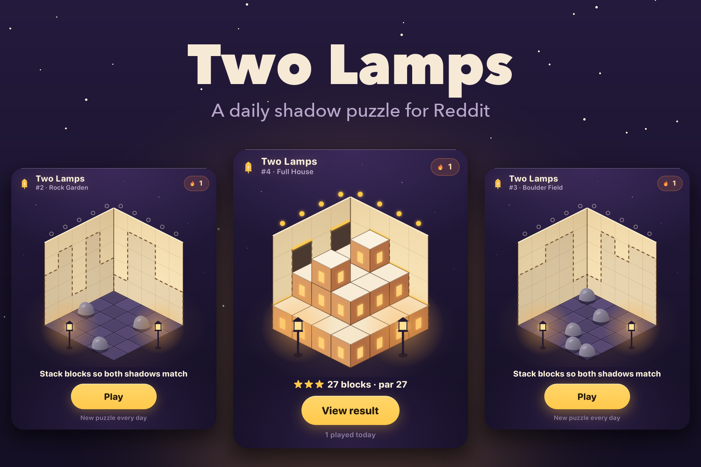
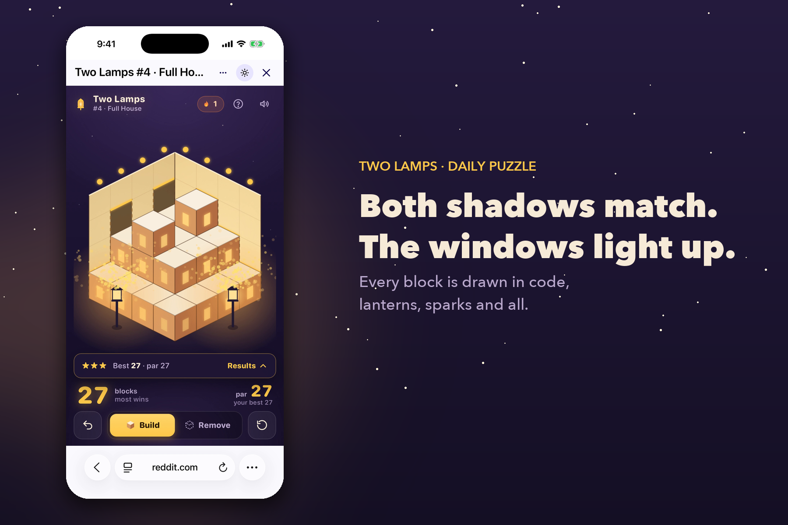
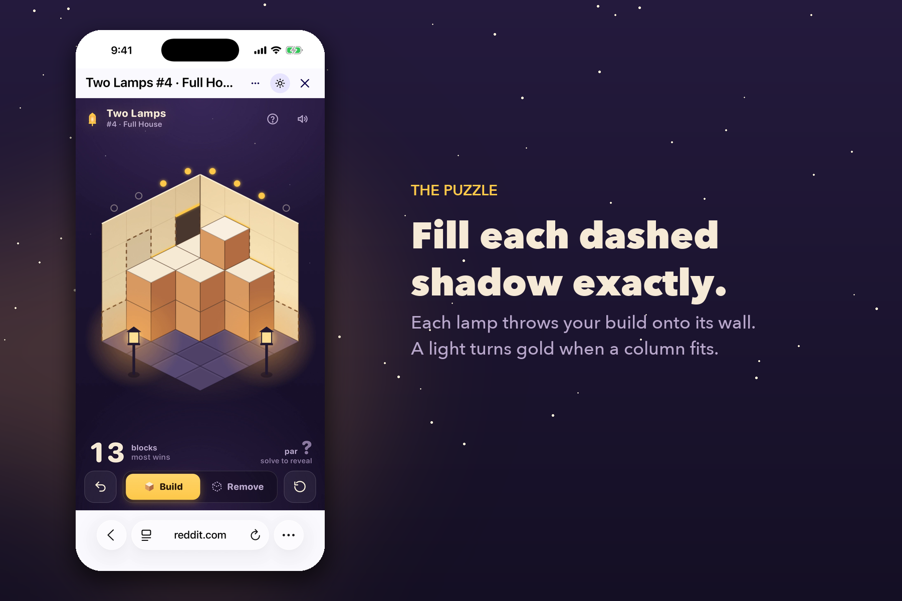
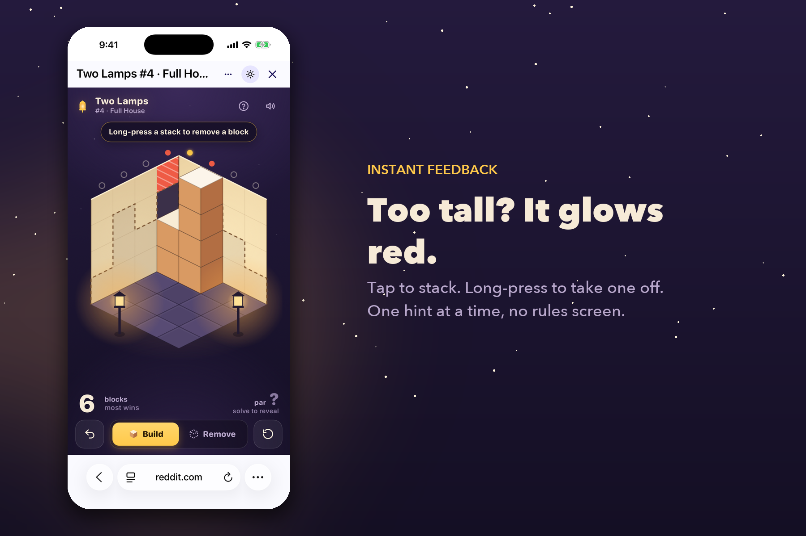
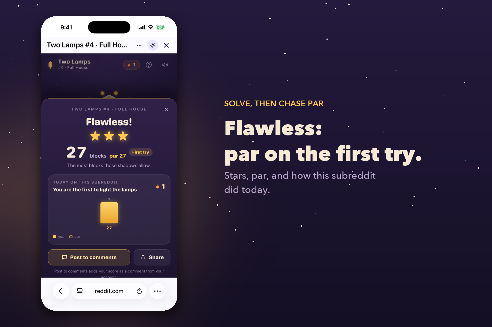
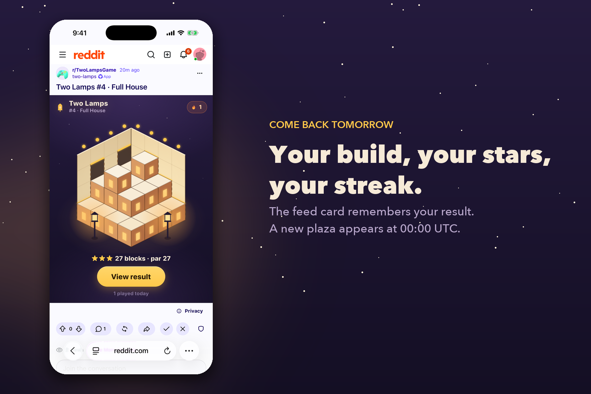

<p align="center">
  
</p>

<h1 align="center">Two Lamps</h1>

<p align="center"><b>Stack blocks so both shadows match. A new plaza every day.</b><br>
A daily puzzle that lives inside a Reddit post, built on Reddit's Developer Platform (Devvit Web).</p>

<p align="center">
  <a href="https://www.reddit.com/r/TwoLampsGame/">▶ Play on r/TwoLampsGame</a> ·
  <a href="https://developers.reddit.com/apps/two-lamps">App listing</a> ·
  <a href="https://youtu.be/HnOmt2mEe-A">Demo video (57 s)</a>
</p>

---

## How to play

Two lanterns light a small plaza. Each lamp throws the shadow of whatever you build onto its own plaster wall.

1. **Tap a tile** to stack a block. **Long-press** (or switch to **Remove**) to take one off.
2. **Fill each dashed silhouette exactly.** The light above a wall column turns **gold** when that column matches, and **red** when it's too tall.
3. **Match both walls** and the windows light up. That solves the puzzle, and **par** is revealed.
4. **Chase par**: the fewest blocks those shadows allow. One tall tower standing where a tall row meets a tall column shades *both* walls; that is the trick.

There is no failure state: everyone solves; the competition is how *well*. Reaching par without resetting earns a **First try** badge.

### A new twist each weekday (UTC)

| Mon | Tue | Wed | Thu | Fri | Sat | Sun |
|---|---|---|---|---|---|---|
| **Warm-up**, a 4×4 plot | **Big Plot**, 5×5 | **Rock Garden**, nothing stands on rocks | **Boulder Field**, more rocks | **Full House**, same shadows but the **most** blocks wins | **Third Lamp**, a lamp overhead lights the exact tiles you must fill | **Grand Plot**, 5×5 |

## Screenshots

| | |
|---|---|
|  |  |
|  |  |
|  |  |

All screenshots are real captures of the live app on r/TwoLampsGame, taken on Reddit mobile web in an iPhone 17 simulator.

## What makes it Reddit-native

- **The post is the game.** The feed card shows today's real puzzle. Once you've played, it shows your lit build and stars.
- **A daily post on autopilot.** A scheduler job posts "Two Lamps #N · Twist" at 00:00 UTC. Installing the app posts the first one, and a moderator menu item is the manual fallback.
- **The community is the scoreboard.** Every result card shows *this subreddit's* histogram for the day, with your bar highlighted.
- **Comments, opt-in.** **Post to comments** adds your result from your account, only when you tap it and once per puzzle:
  `🏮 Two Lamps #4 · Full House / ★★★ 27 blocks (par 27, most possible) · first try`
- **Streak flair, opt-in.** "🏮 Two Lamps · 🔥 5-day streak", refreshed on every daily solve.
- **Native share sheet**, with a clipboard fallback.

## Architecture

```
src/
├─ shared/            runs on BOTH client and server
│  ├─ engine.ts       shadows (projections), validation, exact par, stars, seeded RNG
│  ├─ daily.ts        UTC date → deterministic puzzle + weekday twist + quality filters
│  ├─ stats.ts        "better than X%" from the day's histogram
│  └─ engine.test.ts  par vs. exhaustive search; 60-day generator check
├─ server/            Hono on Devvit's serverless Node runtime
│  ├─ routes/api.ts   GET /api/state · POST /api/solve · /api/share · /api/flair
│  ├─ core/game.ts    re-verify builds, records, histogram, streaks, flair, share text (Redis)
│  ├─ core/daily.ts   one post per subreddit per UTC day
│  └─ routes/         scheduler (cron 0 0 * * *), install trigger, mod menu
└─ client/            React 19 + Canvas 2D, built with Vite
   ├─ splash.tsx      inline feed card (today's plaza, never scrolls)
   └─ game/           App (screen + hints), Board + scene (isometric renderer, input),
                      ResultSheet, HowTo, sound (Web Audio, synthesised)
```

**Exact par.** At each height `h`, every row and column whose target is `h` needs a stack of exactly `h`. One stack can serve a row and a column only when both targets are `h`, so:

`par = Σ_h h · (rows_h + cols_h − maxMatching_h)`

`maxMatching_h` is the maximum bipartite matching over buildable tiles. Rocks remove edges. The overhead footprint costs 1 per tile, plus `h − 1` per raised stack. Full House uses the closed-form maximum, `min(R_i, C_j)` on every allowed tile. The unit tests check par against brute force over every possible build.

**Fair scoring.** The client sends only the build. The server regenerates the day's puzzle from the date, re-validates the build, and computes blocks and stars itself before saving anything.

**Redis keys:**

| Key | Holds |
|---|---|
| `rec:{day}` | Each player's best |
| `hist:{day}` | The day's histogram |
| `par:{day}` | Who reached par |
| `streak:{user}` | Last day, count, max |
| `flair:{user}` | Flair opt-in |
| `shared:{day}:{user}` | Once-per-puzzle comment lock |
| `daily:{day}:post` | Guard against a second daily post |

**No game assets.** Every visual in the game is drawn in code and every sound is synthesised, so there are no images, fonts, audio files or external requests.

## Run it yourself

Requirements: Node 24+, a Reddit account connected to Reddit Developers.

```bash
npm install
```

```bash
npx devvit login
```

```bash
npm run dev
```

`npm run dev` uploads a playtest build to a private dev subreddit and live-reloads on save.

| Command | What it does |
|---|---|
| `npm run dev` | Playtest on your dev subreddit |
| `npm run build` | Build client and server into `dist/` |
| `npm run test:unit` | Engine and generator tests (Node test runner) |
| `npm run test:types` / `npm run lint` | Type check and lint |
| `npm run deploy` | Type check, lint and upload a new version (no publishing) |
| `npx devvit install r/YourSubreddit` | Install the uploaded app on a small subreddit |

**Visual harness (no Reddit needed).** Run the command below, then open `http://localhost:5199/index.html?day=2026-11-20` (or `/splash.html`).

```bash
npx vite --config tools/harness/vite.config.ts
```

The harness serves the real client with a mocked Devvit client and API. Query parameters:
- `anon=1`: play logged out.
- `streak=N`: set the streak.
- `hist={"13":3}`: seed other players' results.

## Submission materials

Everything for the Devpost entry is in [`submission/`](submission/README.md): the copy, a requirements checklist, the video, subtitles and the screenshots.

## Credits and licence

- Game design, code and visuals: the Two Lamps author, for Reddit's Game of the Day Hackathon 2026.
- Scaffolded from Reddit's official [`devvit-template-react`](https://github.com/reddit/devvit-template-react) (BSD-3-Clause; see `LICENSE`).
- The projection idea follows a long tradition of multi-view block puzzles. Two Lamps is an original daily take on it, with no assets or code from any existing game.
